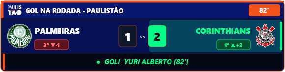

<div align="center">

# ⚽ LiveRoundGoals v1.4

**Notificaciones de Gol en la Jornada estilo TV con Transición 3D, Temas Personalizables y Resultados en Tiempo Real para eFootball PES 2021 (Sider)**

[](../../releases)
[](#compatibilidad)
[](#instalación)
[](THEMES_GUIDE.md)

**Idiomas:** 🇺🇸 [English](README.md) | 🇧🇷 [Português (Brasil)](README.pt-BR.md) | 🇪🇸 **Español**

<br/>


</div>

---

## ✨ Características

- **⚽ Transición 3D Suave del Balón (Estilo TV "Gol da Rodada"):**
  - Animación 3D fluida en GPU de un balón giratorio que despliega suavemente la tarjeta de gol sin tirones.
  - Cambia el estilo en vivo con **`F11`** o en `theme.ini` (`Balón 3D Globo [Defecto]`, `Balón 3D Rebote`, `Deslize TV`, `Zoom Suave`).
- **🎨 Temas y Fuentes Personalizables ([Ver Guía de Temas](THEMES_GUIDE.md)):**
  - Personaliza colores, opacidad, bordes, transición 3D y **cualquier fuente de Windows o archivo `.ttf`/`.otf`** en `modules\LiveRoundGoals\themes\<tema>\theme.ini`.
  - Incluye 3 temas listos (`globo_classic`, `ucl_neon`, `minimal_dark`) intercambiables con **`F7`** + soporte para compartir temas en GitHub!
- **🌟 Soporte Oficial para Liga Máster y Ser una Leyenda (BAL):**
  - Funciona oficialmente en **Liga Máster** y **Ser una Leyenda (BAL)**, incluyendo entrada desde el banquillo en la 2ª parte sin spam de tarjetas antiguas.
- **📅 Filtro de Jornada Alternable (`F8`):**
  - **Mismo Día y Hora (Por defecto):** Muestra solo los partidos del mismo día y horario que tu encuentro.
  - **Jornada Completa:** Pulsa **`F8`** (o `[2]` en Sider) para alternar y ver todos los partidos de la jornada.
- **📺 Alertas de Gol estilo Transmisión de TV:**
  - Tarjetas nativas D3D11/Direct2D con temas para **25+ competiciones oficiales**, `DOBLETE` / `HAT-TRICK!` / `GOLEADA`, clasificación en vivo (`▲` / `▼`), filtro de grupos (`[6]`), multi-idioma (`PT-BR` / `EN` / `ES` + `F6`) y sonido sincronizado (`[4]` / `[5]`).
- **🫥 Transparencia Inteligente (Auto-Fade con el Balón):**
  - Se vuelve transparente (`25%`) solo cuando el balón pasa por la esquina ocupada por la tarjeta.
- **📊 Panel de Resultados de la Jornada (Pausa / Descanso / Final):**
  - Navega con **`R3` / `L3`** en mando **o** **`]` / `[`** (`RePág` / `AvPág`, `Numpad 7/9`) en teclado para abrir la **Cuadrícula Doble Broadcast (2 Columnas)**.

---

## 🖼️ Vistas Previas

<p align="center">
  
  
</p>
<p align="center">
  
  
</p>
<p align="center">
  
  
</p>
<p align="center">
  
</p>
<p align="center">
  
</p>

---

## 📦 Instalación

> ⚠️ **Aviso de Compatibilidad de Parches:** Este mod fue **creado y desarrollado sobre BMPES**, y recibió **algunas correcciones para SP Football Life 2027 (FL27)** *(puede funcionar o no según tu instalación)*. Sobre **otros parches**, no garantizamos que funcione correctamente.

1. Descarga **`LiveRoundGoals_v1.4.zip`** desde la pestaña [Releases](../../releases) (o copia la carpeta `modules` de este paquete).
2. Extrae/copia la carpeta **`modules`** dentro de tu carpeta principal de PES 2021 / Sider (donde está `sider.ini`).
3. Abre **`sider.ini`** con el Bloc de notas y verifica que estas opciones estén activadas:
   ```ini
   luajit.ext.enabled = 1
   match-stats.enabled = 1
   ```
4. Añade esta línea a la lista de módulos Lua en **`sider.ini`**:
   ```ini
   lua.module = "LiveRoundGoals.lua"
   ```
5. Guarda `sider.ini` e inicia el juego normalmente desde **Sider**.

---

## 🎮 Controles (Mando y Teclado Sin Conflictos)

### Dentro del Menú de Pausa / Descanso / Final del Partido
| Mando | Teclado *(teclas libres, sin conflicto)* | Acción |
| :--- | :--- | :--- |
| **`R3`** *(Clic Stick Derecho)* | **`]`** o **`AvPág`** o **`Numpad 9`** | Abrir Resultados de la Jornada / Página Siguiente |
| **`L3`** *(Clic Stick Izquierdo)* | **`[`** o **`RePág`** o **`Numpad 7`** | Página Anterior / Volver a Estadísticas |
| **`Y` / Triángulo** o **`SELECT`** | **`F10`** o **`Numpad 0`** | Ocultar / Mostrar Overlay |
| **`A` / `X`** | **`Backspace`** | Cerrar Panel y Volver a Estadísticas |

### Atajos Globales de Teclado *(funcionan en cualquier momento sin abrir Sider)*
| Tecla | Acción |
| :--- | :--- |
| **`F6`** | Cambiar Idioma (`PT-BR` / `EN` / `ES`) |
| **`Insert`** | Cambiar Tema Personalizado (`auto` / carpeta `themes\`) |
| **`Home`** | Alternar Filtro de Jornada *(Mismo Día/Hora [Defecto] / Jornada Completa)* |
| **`F9`** | Lanzar Tarjeta 3D de Prueba *(enfriamiento de 3s)* |
| **`F10`** / **`SELECT + L3`** | Ocultar / Mostrar Overlay en Partido o Menús |
| **`End`** | Cambiar Transición 3D *(Balón 3D Globo / Rebote / Deslize / Zoom)* |

### Panel de Sider (`Barra Espaciadora`)
| Tecla *(con el panel de Sider abierto)* | Acción |
| :--- | :--- |
| **`[1]`** / **`[2]`** | Cambiar Tema / Alternar Filtro de Jornada |
| **`[3]`** | Cambiar Idioma (`PT-BR` / `EN` / `ES`) |
| **`[4]` / `[5]`** | Bajar / Subir Volumen del Sonido de Gol (`-10%` / `+10%`) |
| **`[6]`** | Cambiar Filtro de Grupos *(Solo Mi Grupo [Defecto] / Overlay + Menú / Toda la Jornada)* |
| **`[7]`** | Cambiar Esquina de Pantalla |
| **`[8]` / `[9]`** | Reducir / Aumentar Escala (`-5%` / `+5%`) |
| **`[-]` / `[=]`** y **`RePág` / `AvPág`** | Ajuste Fino de Posición X / Y |
| **`[0]`** | Activar / Desactivar Auto-Fade con el Balón |
| **`[U]`** | Instalar Actualización Automática de GitHub *(cuando esté disponible — preserva `config.ini` y temas)* |
| **`[BACKSPACE]`** | Restaurar Valores por Defecto |

---

## 🛡️ Compatibilidad e Integridad

- **Base de Desarrollo:**
  - ✅ **BMPES** *(parche principal donde se creó y probó el mod)*
  - ⚠️ **SP Football Life 2027 (`FL27`)** *(incluye correcciones de compatibilidad; puede funcionar o no según la compilación)*
  - ❓ **Otros Parches (VirtuaRED, Dream Patch, SmokePatch, Gogosz, MARFUT, etc.):** *No garantizamos su funcionamiento, aunque incluye lectura dinámica de RAM y `.cpk`.*
- Compatible con ejecutables **Steam v1.07.02** y **CPY v1.1.0**, cualquier versión de Sider 7.x, teclado y mandos XInput / DirectInput (DualSense/DualShock/USB).
- Renderizado nativo en C++ / Direct2D / D3D11 con indexación asíncrona de `.cpk` (cero tirones) y sello de integridad entre `LiveRoundGoals.lua` y `LiveRoundGoals.dll`. No modifiques ni renombres `LiveRoundGoals.lua`.

---

## 📜 Licencia y Términos de Uso

**Copyright © 2026 uWaazy — Todos los Derechos Reservados.** Consulta el archivo completo en [LICENSE](LICENSE).

> 🆓 **MOD 100% GRATUITO:** LiveRoundGoals es totalmente gratis. **Si pagaste a alguien por este mod, fuiste estafado.**

- ✅ **Permitido:** Descarga gratuita y uso personal, no comercial y offline en PES 2021 / SP Football Life.
- ❌ **Prohibido sin autorización del autor (uWaazy):** Resubir o duplicar los archivos, incluirlos en parches o modpacks de terceros *(los creadores de parches interesados en integrarlo de forma nativa deben contactar con uWaazy)*, uso comercial o reventa, o ingeniería inversa/modificación de `LiveRoundGoals.dll` y `LiveRoundGoals.lua`.
- ⚠️ **Descargo de Responsabilidad:** Se entrega **"TAL CUAL" ("AS IS")**, sin garantías. Destinado exclusivamente a modos offline (Liga Máster, Liga, Copa).
