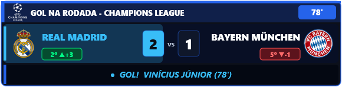
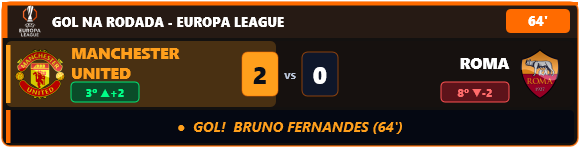
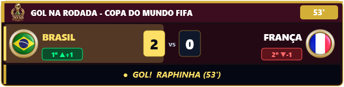
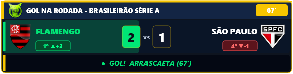
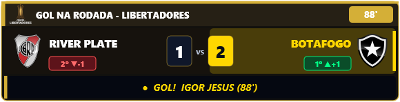
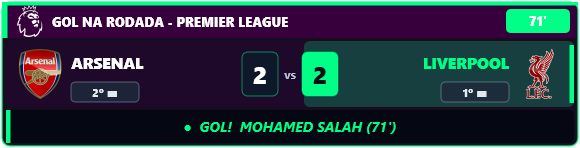
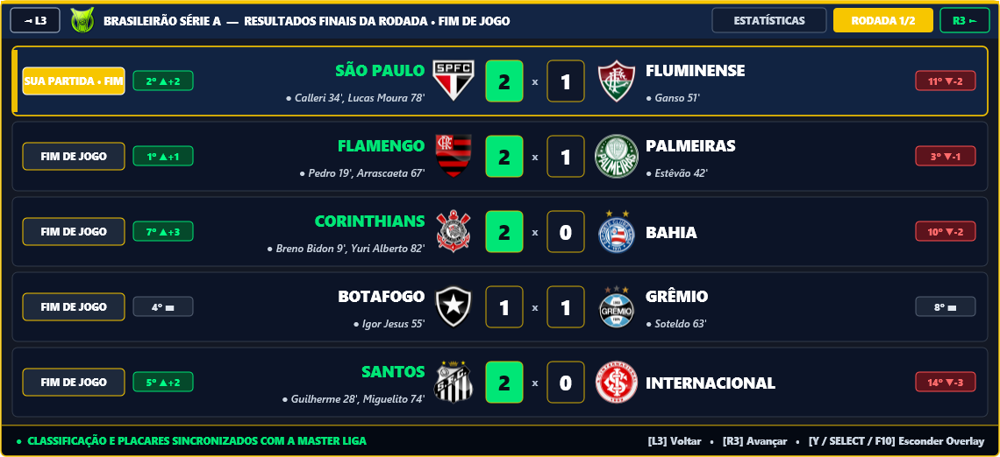

<div align="center">

# ⚽ LiveRoundGoals v1.0

**Notificaciones de Gol en la Jornada estilo TV y Resultados en Tiempo Real para eFootball PES 2021 (Sider)**

[](../../releases)
[](#compatibilidad)
[](#instalación)

**Idiomas:** 🇺🇸 [English](README.md) | 🇧🇷 [Português (Brasil)](README.pt-BR.md) | 🇪🇸 **Español**

</div>

---

## ✨ Características

- **📺 Alertas de Gol estilo Transmisión de TV:**
  - Tarjetas nativas en Direct3D 11 / Direct2D mostradas en tiempo real cada vez que hay un gol en otros partidos de la jornada en Liga Master, Liga o Copa.
  - Temas visuales dinámicos por competición (Champions League, Europa League, Copa del Mundo FIFA, Libertadores, Sudamericana, Brasileirão, Premier League, LaLiga, Serie A, Bundesliga, Paulistão y más) con escudos reales y logos oficiales.
  - **Clasificación en Vivo (`▲` / `▼`):** Muestra la posición actual de cada equipo y cuántos puestos sube o baja en el instante del gol.
  - **Filtro Inteligente de Fase de Grupos (Activo por Defecto):** En torneos de grupos, las alertas durante el partido muestran por defecto solo los goles de **tu grupo** (configurable en el panel de Sider con la tecla `[6]`).
- **🫥 Transparencia Inteligente (Auto-Fade con el Balón):**
  - La tarjeta se vuelve transparente (`25%`) automáticamente solo cuando el jugador con el balón pasa justo por encima de la esquina donde aparece el marcador.
- **📊 Panel de Resultados de la Jornada (Pausa / Descanso / Final del Partido):**
  - Comienza **desactivado por defecto** en una barra inferior compacta (sin tapar las estadísticas del partido) y acompaña suavemente la animación de entrada del menú de PES 2021.
  - Pulsa **`R3` / `L3`** para abrir la **Cuadrícula Doble Broadcast (2 Columnas)** con los partidos simultáneos/restantes de la jornada, marcadores, goleadores y posiciones.
  - **100% Sincronizado con Liga Master:** Todos los marcadores mostrados en vivo se registran exactamente en la tabla oficial de la competición.

---

## 🖼️ Vistas Previas

<p align="center">
  
  
</p>
<p align="center">
  
  
</p>
<p align="center">
  
  
</p>
<p align="center">
  
</p>

---

## 📦 Instalación

> Compatible con **cualquier parche de PES 2021** (BMPES, SmokePatch, Football Life, VirtuaRED, Dream Patch, etc.) que use **Sider**.

1. Descarga **`LiveRoundGoals_v1.0.zip`** desde la pestaña [Releases](../../releases) (o copia la carpeta `modules` de este paquete).
2. Extrae/copia la carpeta **`modules`** dentro de tu carpeta principal de PES 2021 / Sider (donde está `sider.ini`).
3. Abre **`sider.ini`** con el Bloc de notas y verifica que estas opciones estén activadas:
   ```ini
   luajit.ext.enabled = 1
   match-stats.enabled = 1
   ```
4. Añade esta línea a la lista de módulos Lua en **`sider.ini`**:
   ```ini
   lua.module = "LiveRoundGoals.lua"
   ```
5. Guarda `sider.ini` e inicia el juego normalmente desde **Sider**.

---

## 🎮 Controles

### Dentro del Menú de Pausa / Descanso / Final del Partido
| Botón / Tecla | Acción |
| :--- | :--- |
| **`R3`** (Clic en Stick Derecho) / **`]`** | Abrir Resultados de la Jornada / Página Siguiente |
| **`L3`** (Clic en Stick Izquierdo) / **`[`** | Página Anterior / Volver a Estadísticas |
| **`Y` / Triángulo** o **`SELECT`** o **`F10`** | Ocultar / Mostrar Overlay |

### Durante el Partido y en el Panel de Sider (`Barra Espaciadora`)
| Botón / Tecla | Acción |
| :--- | :--- |
| **`SELECT + L3`** o **`F10`** | Ocultar / Mostrar Alertas en el Partido |
| **`F9`** | Lanzar Notificación de Prueba |
| **`[6]`** *(en el panel de Sider)* | Cambiar Filtro de Grupos *(Solo Mi Grupo [Defecto] / Overlay + Menú / Toda la Jornada)* |
| **`[7]`** *(en el panel de Sider)* | Cambiar Esquina de Pantalla |
| **`[8]` / `[9]`** *(en el panel de Sider)* | Reducir / Aumentar Escala (`-5%` / `+5%`) |
| **`[-]` / `[=]`** y **`RePág` / `AvPág`** *(en Sider)* | Ajuste Fino de Posición X / Y |
| **`[0]`** *(en el panel de Sider)* | Activar / Desactivar Auto-Fade con el Balón |
| **`[BACKSPACE]`** *(en el panel de Sider)* | Restaurar Valores por Defecto |

---

## 🛡️ Compatibilidad e Integridad

- Compatible con ejecutables **Steam v1.07.02** y **CPY v1.1.0**.
- Renderizado nativo en C++ / Direct2D / D3D11 con sello de integridad entre `LiveRoundGoals.lua` y `LiveRoundGoals.dll`. No modifiques ni renombres `LiveRoundGoals.lua`.
