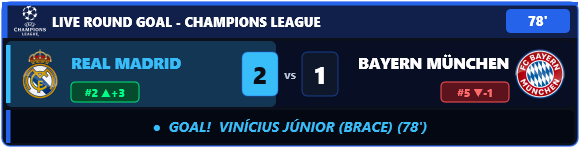
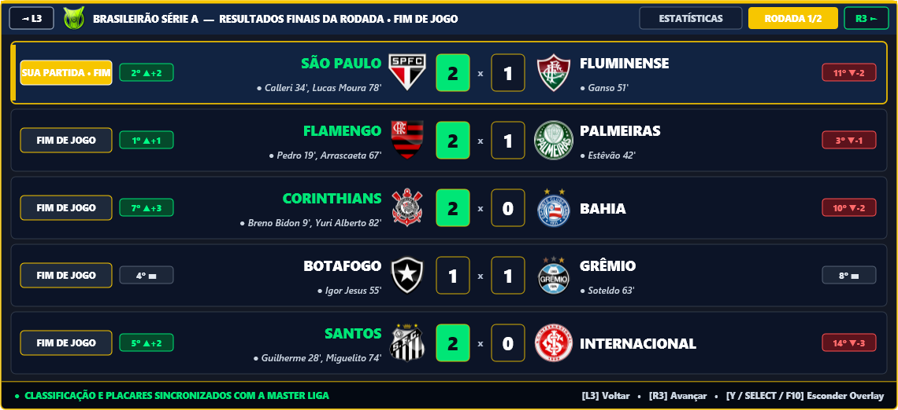

<div align="center">

# ⚽ LiveRoundGoals v1.4

**Real-Time Broadcast Goal Notifications with 3D Ball Transition, Custom Themes & Live Round Results for eFootball PES 2021 (Sider)**

[](../../releases)
[](#compatibility)
[](#installation)
[](THEMES_GUIDE.md)

**Languages:** 🇺🇸 **English** | 🇧🇷 [Português (Brasil)](README.pt-BR.md) | 🇪🇸 [Español](README.es.md)

<br/>


</div>

---

## ✨ Features

- **⚽ Smooth 3D Ball Transition ("Gol da Rodada" Broadcast Style):**
  - Real-time GPU 3D-shaded spinning football animation that smoothly reveals and retracts the goal card at full frame rate with zero stutter.
  - Cycle styles live with **`F11`** or customize in `theme.ini` (`3D Ball Globo [Default]`, `3D Ball Elastic Bounce`, `TV Slide`, `Smooth Zoom`), including ball colors, spin speed, and duration.
- **🎨 User-Customizable Themes & Fonts ([Read the Themes Guide](THEMES_GUIDE.md)):**
  - Edit colors, opacity, borders, rounded corners, 3D transition, and **any Windows font or custom `.ttf`/`.otf` file** in `modules\LiveRoundGoals\themes\<theme>\theme.ini`.
  - Ships with 3 starter themes (`globo_classic`, `ucl_neon`, `minimal_dark`) switchable live with **`F7`**, plus GitHub community theme submission support!
- **🌟 Official Master League & Become a Legend (BAL) Support:**
  - Officially supports both **Master League** and **Become a Legend (BAL)**, including silent score catch-up when subbed on mid-match without spamming old notifications.
- **📅 Toggleable Round Match Filter (`F8`):**
  - **Same Day & Time (Default):** Shows only matches scheduled on the same day and time window as your match.
  - **Full Round:** Press **`F8`** (or `[2]` in Sider) anytime to toggle and track all matches of the entire round.
- **📺 TV Broadcast Goal Alerts ("Gol na Rodada"):**
  - Real-time Direct3D 11 / Direct2D cards with dynamic themes for **25+ official competitions**, real club crests, `BRACE` / `HAT-TRICK!` / `ROUT` highlights, live standings delta (`▲` / `▼`), group-stage filter (`[6]`), multi-language (`PT-BR` / `EN` / `ES` with auto-detection + `F6`), and synced goal audio (`[4]` / `[5]`).
- **🫥 Smart Ball-Occlusion Auto-Fade:**
  - Automatically fades to `25%` opacity only when the player carrying the ball passes over the corner occupied by the card.
- **📊 Integrated Round Results Panel (Pause / Halftime / Fulltime):**
  - Starts **disabled by default** on a compact bottom bar synced with PES 2021's menu animation.
  - Press **`R3` / `L3`** on controller **or** **`]` / `[`** (`PgUp` / `PgDn`, `Numpad 7/9`) on keyboard to open the **2-Column Broadcast Grid** 100% synced with official career standings.

---

## 🖼️ Previews

<p align="center">
  
  
</p>
<p align="center">
  
  
</p>
<p align="center">
  
  
</p>
<p align="center">
  
</p>
<p align="center">
  
</p>

---

## 📦 Installation

> ⚠️ **Patch Compatibility Notice:** This mod was **built and developed on top of BMPES**, and received **some fixes for SP Football Life 2027 (FL27)** *(may or may not work depending on your build/setup)*. Compatibility with **other patches** is not guaranteed.

1. Download the latest **`LiveRoundGoals_v1.4.zip`** from the [Releases](../../releases) tab (or copy the `modules` folder from this package).
2. Extract/copy the **`modules`** folder into your main PES 2021 / Sider directory (where `sider.ini` is located).
3. Open **`sider.ini`** in Notepad and ensure these options are enabled:
   ```ini
   luajit.ext.enabled = 1
   match-stats.enabled = 1
   ```
4. Add this line to your Lua modules list in **`sider.ini`**:
   ```ini
   lua.module = "LiveRoundGoals.lua"
   ```
5. Save `sider.ini` and launch the game through **Sider**.

---

## 🎮 Controls (Controller & Conflict-Free Keyboard)

### Inside Pause / Halftime / Fulltime Menu
| Controller | Keyboard *(unused keys, zero conflict)* | Action |
| :--- | :--- | :--- |
| **`R3`** *(Right Stick Click)* | **`]`** or **`PageDown`** or **`Numpad 9`** | Open Round Results / Next Page |
| **`L3`** *(Left Stick Click)* | **`[`** or **`PageUp`** or **`Numpad 7`** | Previous Page / Back to Stats |
| **`Y` / Triangle** or **`SELECT`** | **`F10`** or **`Numpad 0`** | Hide / Show Overlay |
| **`A` / `X`** | **`Backspace`** | Close Panel & Return to Stats |

### Global Keyboard Shortcuts *(work anytime without opening Sider)*
| Key | Action |
| :--- | :--- |
| **`F6`** | Switch Language (`PT-BR` / `EN` / `ES`) |
| **`Insert`** | Cycle Custom Theme (`auto` / themes inside `themes\`) |
| **`Home`** | Toggle Round Filter *(Same Day & Time [Default] / Full Round)* |
| **`F9`** | Trigger 3D Test Goal Notification *(3s cooldown)* |
| **`F10`** / **`SELECT + L3`** | Hide / Dismiss Overlay in Match or Menus |
| **`End`** | Cycle 3D Transition Style *(3D Ball Globo / Bounce / Slide / Zoom)* |

### Sider Overlay (`Spacebar`)
| Input *(in Sider menu)* | Action |
| :--- | :--- |
| **`[1]`** / **`[2]`** | Cycle Custom Theme / Toggle Round Filter |
| **`[3]`** | Switch Language (`PT-BR` / `EN` / `ES`) |
| **`[4]` / `[5]`** | Decrease / Increase Goal Alert Sound Volume (`-10%` / `+10%`) |
| **`[6]`** | Toggle Group Filter *(My Group Only [Default] / My Group + Menu / Full Round)* |
| **`[7]`** | Cycle Screen Corner |
| **`[8]` / `[9]`** | Decrease / Increase Card Scale (`-5%` / `+5%`) |
| **`[-]` / `[=]`** & **`PgUp` / `PgDn`** | Fine-tune X / Y Position |
| **`[0]`** | Toggle Smart Ball Auto-Fade |
| **`[U]`** | Install Automatic GitHub Update *(when available — preserves `config.ini` & themes)* |
| **`[BACKSPACE]`** | Reset Default Layout |

---

## 🛡️ Compatibility & Integrity

- **Development Base:**
  - ✅ **BMPES** *(primary patch where this mod was built and tested)*
  - ⚠️ **SP Football Life 2027 (`FL27`)** *(received compatibility fixes; may or may not work depending on build/setup)*
  - ❓ **Other Patches (VirtuaRED, Dream Patch, SmokePatch, Gogosz, MARFUT, etc.):** *Not guaranteed to work, though dynamic RAM & `.cpk` readers are included.*
- Supports **Steam v1.07.02** and **CPY v1.1.0** executables with any Sider 7.x build, keyboard, and XInput / DirectInput (DualSense/DualShock/USB) controllers.
- Native C++ / Direct2D / D3D11 rendering with asynchronous background `.cpk` indexing (zero gameplay stutter) and integrity seal between `LiveRoundGoals.lua` and `LiveRoundGoals.dll`. Do not rename or modify `LiveRoundGoals.lua`.

---

## 📜 License & Terms of Use

**Copyright © 2026 uWaazy — All Rights Reserved.** See the full [LICENSE](LICENSE) file.

> 🆓 **100% FREE MOD:** LiveRoundGoals is completely free. **If you paid anyone for this mod, you were scammed.**

- ✅ **Allowed:** Free download and personal, non-commercial offline use in PES 2021 / SP Football Life.
- ❌ **Prohibited without permission from uWaazy:** Re-uploading/mirroring files, bundling into third-party patches/modpacks *(patch creators interested in native integration must contact uWaazy first)*, commercial use/resale, or reverse-engineering/modifying `LiveRoundGoals.dll` and `LiveRoundGoals.lua`.
- ⚠️ **Disclaimer:** Provided **"AS IS"** without warranty. Intended strictly for offline modes (Master League, League, Cup).
