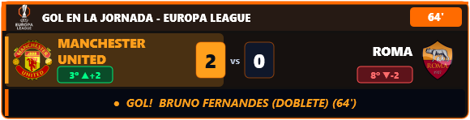
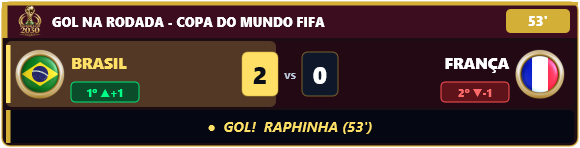
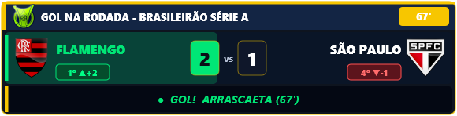
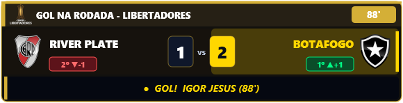
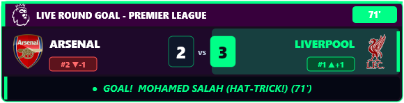

<div align="center">

# ⚽ LiveRoundGoals v1.2

**Real-Time Broadcast Goal Notifications & Live Round Results for eFootball PES 2021 (Sider)**

[](../../releases)
[](#compatibility)
[](#installation)

**Languages:** 🇺🇸 **English** | 🇧🇷 [Português (Brasil)](README.pt-BR.md) | 🇪🇸 [Español](README.es.md)

</div>

---

## ✨ Features

- **📺 TV Broadcast Goal Alerts ("Gol na Rodada"):**
  - Real-time Direct3D 11 / Direct2D pop-up cards whenever a goal is scored in parallel Master League, League, or Cup matches.
  - Dynamic competition themes (Champions League, Europa League, FIFA World Cup, Libertadores, Sul-Americana, Brasileirão Série A/B/C/D, Premier League, LaLiga, Serie A, Bundesliga, Paulistão, and more) with real club crests and league logos.
  - **Live Standings Delta (`▲` / `▼`):** Shows each club's live table position and how many places they climbed or dropped after each goal.
  - **Group-Stage Smart Filter (Default ON):** During group-stage matches, live TV alerts automatically notify only goals from **your group** by default (switchable in-game via Sider overlay `[6]`).
- **🫥 Smart Ball-Occlusion Auto-Fade:**
  - Automatically turns transparent (`25%`) only when the player carrying the ball passes directly over the corner where the card is displayed.
- **📊 Integrated Round Results Panel (Pause / Halftime / Fulltime):**
  - Starts **disabled by default** on a compact bottom bar so native match stats remain 100% visible, and slides smoothly in sync with PES 2021's menu animation.
  - Press **`R3` / `L3`** to open the **2-Column Broadcast Grid** showing all remaining/simultaneous matches of the round with live scores, goal scorers, and group/league positions.
  - **100% Synced with Master League:** Every score shown in the live alerts and round panel is written directly into Master League's official standings and fixture table.

---

## 🖼️ Previews

<p align="center">
  
  
</p>
<p align="center">
  
  
</p>
<p align="center">
  
  
</p>
<p align="center">
  
</p>

---

## 📦 Installation

> Compatible with **any PES 2021 patch** (BMPES, SmokePatch, Football Life, VirtuaRED, Dream Patch, etc.) running **Sider**.

1. Download the latest **`LiveRoundGoals_v1.2.zip`** from the [Releases](../../releases) tab (or copy the `modules` folder from this package).
2. Extract/copy the **`modules`** folder into your main PES 2021 / Sider directory (where `sider.ini` is located).
3. Open **`sider.ini`** in Notepad and ensure these options are enabled:
   ```ini
   luajit.ext.enabled = 1
   match-stats.enabled = 1
   ```
4. Add this line to your Lua modules list in **`sider.ini`**:
   ```ini
   lua.module = "LiveRoundGoals.lua"
   ```
5. Save `sider.ini` and launch the game through **Sider**.

---

## 🎮 Controls

### Inside Pause / Halftime / Fulltime Menu
| Input | Action |
| :--- | :--- |
| **`R3`** (Right Stick Click) / **`]`** | Open Round Results / Next Page |
| **`L3`** (Left Stick Click) / **`[`** | Previous Page / Back to Stats |
| **`Y` / Triangle** or **`SELECT`** or **`F10`** | Hide / Show Overlay |

### During Match & Sider Overlay (`Spacebar`)
| Input | Action |
| :--- | :--- |
| **`SELECT + L3`** or **`F10`** | Hide / Dismiss Live Goal Alerts |
| **`F9`** | Trigger Test Goal Notification |
| **`[6]`** *(in Sider menu)* | Toggle Group Filter *(My Group Only [Default] / My Group + Menu / Full Round)* |
| **`[7]`** *(in Sider menu)* | Cycle Screen Corner |
| **`[8]` / `[9]`** *(in Sider menu)* | Decrease / Increase Card Scale (`-5%` / `+5%`) |
| **`[-]` / `[=]`** & **`PgUp` / `PgDn`** *(in Sider menu)* | Fine-tune X / Y Position |
| **`[0]`** *(in Sider menu)* | Toggle Smart Ball Auto-Fade |
| **`[BACKSPACE]`** *(in Sider menu)* | Reset Default Layout |

---

## 🛡️ Compatibility & Integrity

- Supports **Steam v1.27.02** and **CPY v1.2.0** executables.
- Native C++ / Direct2D / D3D11 rendering with integrity verification sealed between `LiveRoundGoals.lua` and `LiveRoundGoals.dll`. Do not rename or modify `LiveRoundGoals.lua`.
