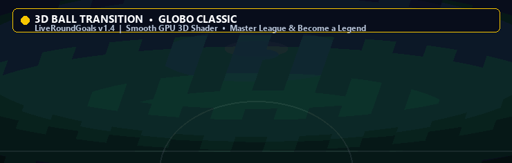
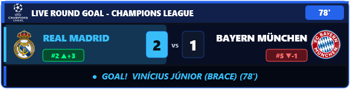
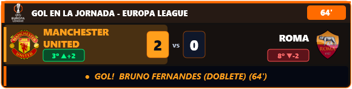
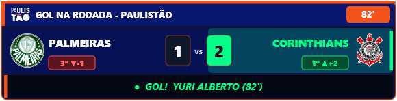
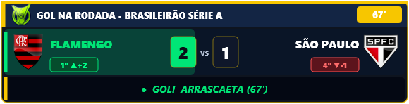
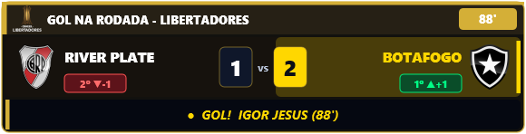
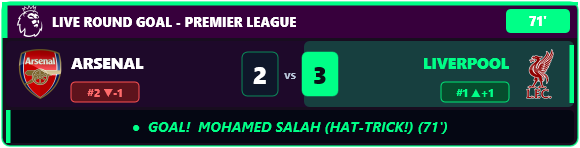
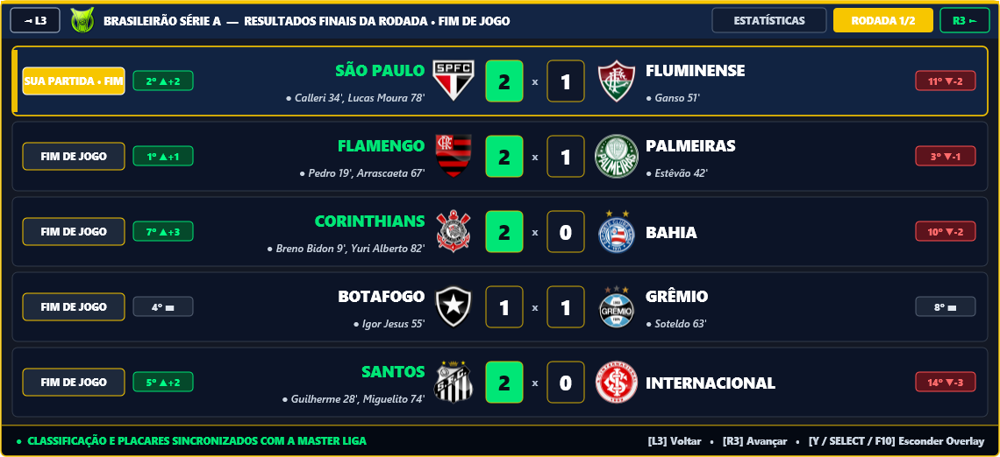

<div align="center">

# ⚽ LiveRoundGoals v1.4

**Notificações de Gol na Rodada estilo TV com Transição 3D, Temas Customizáveis & Resultados da Rodada em Tempo Real para eFootball PES 2021 (Sider)**

[](../../releases)
[](#compatibilidade)
[](#instalação)
[](THEMES_GUIDE.md)

**Idiomas:** 🇺🇸 [English](README.md) | 🇧🇷 **Português (Brasil)** | 🇪🇸 [Español](README.es.md)

<br/>



</div>

---

## ✨ Recursos

- **⚽ Transição 3D Suave "Gol da Rodada" (GPU Shader 3D):**
  - Animação 3D fluida de bola de futebol giratória (inspirada na clássica vinheta "Gol da Rodada" da TV aberta) que abre suavemente o card do placar em tempo real na GPU, sem travamentos.
  - Personalizável em tempo real via **`F11`** ou `theme.ini` (`Bola 3D Globo [Padrão]`, `Bola 3D Quique Elástico`, `Deslize TV`, `Zoom Suave`), com cores da bola, velocidade de giro e duração editáveis.
- **🎨 Temas & Fontes Customizáveis pelo Usuário ([Ver Guia Completo](THEMES_GUIDE.md)):**
  - Edite cores, opacidade, bordas, cantos arredondados, transição 3D e **qualquer fonte do Windows ou arquivo `.ttf`/`.otf`** em `modules\LiveRoundGoals\themes\<tema>\theme.ini`.
  - Já inclui 3 temas prontos (`globo_classic`, `ucl_neon`, `minimal_dark`) alternáveis com **`F7`** + suporte para enviar e compartilhar temas da comunidade no GitHub!
- **🌟 Suporte Oficial à Master Liga & Rumo ao Estrelato (Become a Legend / BAL):**
  - Funciona oficialmente tanto na **Master Liga** quanto no **Rumo ao Estrelato (BAL)**, incluindo entrada vindo do banco no 2º tempo com avanço silencioso dos placares sem spam de cards antigos.
- **📅 Filtro da Rodada Alternável (`F8`):**
  - **Mesmo Dia e Horário (Padrão):** Exibe apenas os outros jogos que acontecem no mesmo dia e janela horária da sua partida.
  - **Rodada Inteira:** Aperte **`F8`** (ou `[2]` no Sider) a qualquer momento para alternar e acompanhar todos os jogos da rodada completa.
- **📺 Alertas de Gol estilo Transmissão de TV ("Gol na Rodada"):**
  - Cards nativos em Direct3D 11 / Direct2D com temas dinâmicos para **25+ competições oficiais**, escudos reais, destaques `2 GOLS` / `HAT-TRICK!` / `GOLEADA`, classificação ao vivo (`▲` / `▼`), filtro de fase de grupos (`[6]`), multi-idioma (`PT-BR` / `EN` / `ES` com auto-detecção + `F6`) e som de gol sincronizado (`[4]` / `[5]`).
- **🫥 Transparência Inteligente (Auto-Fade pela Bola):**
  - O placar fica transparente (`25%`) automaticamente apenas quando o jogador com a bola passa exatamente por cima do canto onde o card está aparecendo.
- **📊 Painel de Resultados da Rodada (Pausa / Intervalo / Fim de Jogo):**
  - Inicia **desativado por padrão** em uma barra compacta inferior e acompanha suavemente o slide do menu do PES 2021.
  - Navegue com **`R3` / `L3`** no controle **ou** **`]` / `[`** (`PgUp` / `PgDn`, `Numpad 7/9`) no teclado para abrir a **Grade Dupla Broadcast (2 Colunas)** 100% sincronizada com a tabela oficial.

---

## 🖼️ Previews

<p align="center">
  
  
</p>
<p align="center">
  
  
</p>
<p align="center">
  
  
</p>
<p align="center">
  
</p>
<p align="center">
  
</p>

---

## 📦 Instalação

> ⚠️ **Aviso de Compatibilidade de Patches:** Este mod foi **criado e desenvolvido em cima do BMPES**, e recebeu **algumas correções para o SP Football Life 2027 (FL27)** *(pode funcionar ou não dependendo da build/configuração)*. Sobre **outros patches**, não temos certeza nem garantia de que funcione corretamente.

1. Baixe o arquivo **`LiveRoundGoals_v1.4.zip`** na aba [Releases](../../releases) (ou copie a pasta `modules` deste pacote).
2. Extraia/copie a pasta **`modules`** para a pasta principal do seu PES 2021 / Sider (onde fica o `sider.ini`).
3. Abra o **`sider.ini`** no Bloco de Notas e confirme que estas opções estão ativas:
   ```ini
   luajit.ext.enabled = 1
   match-stats.enabled = 1
   ```
4. Adicione esta linha na lista de módulos Lua do seu **`sider.ini`**:
   ```ini
   lua.module = "LiveRoundGoals.lua"
   ```
5. Salve o `sider.ini` e abra o jogo normalmente pelo **Sider**.

---

## 🎮 Controles (Controle & Teclado Sem Conflito)

### Dentro do Menu de Pausa / Intervalo / Fim de Jogo
| Controle | Teclado *(livre, sem conflito)* | Ação |
| :--- | :--- | :--- |
| **`R3`** *(Clique Analógico Direito)* | **`]`** ou **`PageDown`** ou **`Numpad 9`** | Abrir Resultados da Rodada / Próxima Página |
| **`L3`** *(Clique Analógico Esquerdo)* | **`[`** ou **`PageUp`** ou **`Numpad 7`** | Página Anterior / Voltar às Estatísticas |
| **`Y` / Triângulo** ou **`SELECT`** | **`F10`** ou **`Numpad 0`** | Esconder / Mostrar Overlay |
| **`A` / `X`** | **`Backspace`** | Fechar Painel e Voltar às Estatísticas |

### Atalhos Globais de Teclado *(funcionam a qualquer momento, sem abrir o Sider)*
| Tecla | Ação |
| :--- | :--- |
| **`F6`** | Alternar Idioma (`PT-BR` / `EN` / `ES`) |
| **`Insert`** | Alternar Tema Customizado (`auto` / temas da pasta `themes\`) |
| **`Home`** | Alternar Filtro da Rodada *(Mesmo Dia e Horário [Padrão] / Rodada Inteira)* |
| **`F9`** | Disparar Notificação 3D de Teste *(cooldown de 3s)* |
| **`F10`** / **`SELECT + L3`** | Esconder / Mostrar Overlay na Partida ou nos Menus |
| **`End`** | Alternar Animação de Transição *(Bola 3D Globo / Quique / Deslize / Zoom)* |

### Painel do Sider (`Barra de Espaço`)
| Tecla *(com painel do Sider aberto)* | Ação |
| :--- | :--- |
| **`[1]`** / **`[2]`** | Alternar Tema Customizado / Alternar Filtro da Rodada |
| **`[3]`** | Alternar Idioma (`PT-BR` / `EN` / `ES`) |
| **`[4]` / `[5]`** | Diminuir / Aumentar Volume do Som de Gol (`-10%` / `+10%`) |
| **`[6]`** | Alternar Filtro de Grupos *(Apenas Meu Grupo [Padrão] / Overlay + Menu / Toda a Rodada)* |
| **`[7]`** | Mudar Canto da Tela |
| **`[8]` / `[9]`** | Diminuir / Aumentar Escala (`-5%` / `+5%`) |
| **`[-]` / `[=]`** e **`PgUp` / `PgDn`** | Ajuste Fino de Posição X / Y |
| **`[0]`** | Ligar / Desligar Auto-Fade pela Bola |
| **`[U]`** | Instalar Atualização Automática do GitHub *(quando disponível — preserva `config.ini` e temas)* |
| **`[BACKSPACE]`** | Restaurar Padrão |

---

## 🛡️ Compatibilidade e Integridade

- **Base de Desenvolvimento:**
  - ✅ **BMPES** *(patch principal onde o mod foi criado e testado)*
  - ⚠️ **SP Football Life 2027 (`FL27`)** *(recebeu correções de compatibilidade; pode funcionar ou não dependendo da versão/instalação)*
  - ❓ **Outros Patches (VirtuaRED, Dream Patch, SmokePatch, Gogosz, MARFUT, etc.):** *Não temos certeza nem garantia de funcionamento, embora o mod possua leitura dinâmica de RAM e `.cpk`.*
- Compatível com executáveis **Steam v1.07.02** e **CPY v1.1.0**, qualquer versão do Sider 7.x, teclado e controles XInput / DirectInput (DualSense/DualShock/USB).
- Renderização nativa em C++ / Direct2D / D3D11 com indexação assíncrona de `.cpk` (zero travamentos) e selo de integridade entre `LiveRoundGoals.lua` e `LiveRoundGoals.dll`. Não modifique nem renomeie o arquivo `LiveRoundGoals.lua`.

---

## 📜 Licença e Termos de Uso

**Copyright © 2026 uWaazy — Todos os Direitos Reservados.** Leia o arquivo completo em [LICENSE](LICENSE).

> 🆓 **MOD 100% GRATUITO:** O LiveRoundGoals é totalmente grátis. **Se você pagou para alguém por este mod, você foi enganado.**

- ✅ **Permitido:** Download gratuito e uso pessoal, não comercial e offline no PES 2021 / SP Football Life.
- ❌ **Proibido sem autorização do autor (uWaazy):** Reupar/espelhar os arquivos, incluir em patches ou modpacks de terceiros *(criadores de patches interessados em integração nativa devem entrar em contato com uWaazy)*, venda/uso comercial, ou engenharia reversa/modificação de `LiveRoundGoals.dll` e `LiveRoundGoals.lua`.
- ⚠️ **Isenção de Responsabilidade:** Fornecido **"NO ESTADO EM QUE SE ENCONTRA" ("AS IS")**, sem garantias. Uso destinado exclusivamente a modos offline (Master Liga, Liga, Copa).
