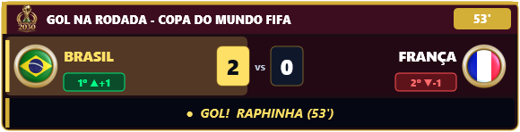

<div align="center">

# ⚽ LiveRoundGoals v1.1

**Notificações de Gol na Rodada estilo TV & Resultados da Rodada em Tempo Real para eFootball PES 2021 (Sider)**

[](../../releases)
[](#compatibilidade)
[](#instalação)

**Idiomas:** 🇺🇸 [English](README.md) | 🇧🇷 **Português (Brasil)** | 🇪🇸 [Español](README.es.md)

</div>

---

## ✨ Recursos

- **📺 Alertas de Gol estilo Transmissão de TV ("Gol na Rodada"):**
  - Cards nativos em Direct3D 11 / Direct2D exibidos em tempo real sempre que sai um gol nos outros jogos da rodada na Master Liga, Liga ou Copa.
  - Temas visuais dinâmicos por campeonato (Champions League, Europa League, Copa do Mundo FIFA, Libertadores, Sul-Americana, Brasileirão Série A/B/C/D, Premier League, LaLiga, Serie A, Bundesliga, Paulistão e mais) com escudos reais e logos oficiais.
  - **Classificação ao Vivo (`▲` / `▼`):** Mostra a posição atual de cada time e quantas posições está subindo ou descendo no momento do gol.
  - **Filtro Inteligente de Fase de Grupos (Padrão Ativo):** Em torneios de grupos, as notificações durante a partida mostram por padrão apenas os gols dos jogos do **seu grupo** (alternável no painel do Sider com a tecla `[6]`).
- **🫥 Transparência Inteligente (Auto-Fade pela Bola):**
  - O placar fica transparente (`25%`) automaticamente apenas quando o jogador com a bola passa exatamente por cima do canto onde o card está aparecendo.
- **📊 Painel de Resultados da Rodada (Pausa / Intervalo / Fim de Jogo):**
  - Inicia **desativado por padrão** em uma barra compacta inferior (sem cobrir as estatísticas da partida) e acompanha suavemente o slide de entrada do menu do PES 2021.
  - Aperte **`R3` / `L3`** para abrir a **Grade Dupla Broadcast (2 Colunas)** com os jogos simultâneos/restantes da rodada, placares, autores dos gols e posições.
  - **100% Sincronizado com a Master Liga:** Todos os placares exibidos ao vivo são exatamente os resultados gravados na tabela oficial do campeonato.

---

## 🖼️ Previews

<p align="center">
  
  
</p>
<p align="center">
  
  
</p>
<p align="center">
  
  
</p>
<p align="center">
  
</p>

---

## 📦 Instalação

> Compatível com **qualquer patch de PES 2021** (BMPES, SmokePatch, Football Life, VirtuaRED, Dream Patch, etc.) que utilize **Sider**.

1. Baixe o arquivo **`LiveRoundGoals_v1.1.zip`** na aba [Releases](../../releases) (ou copie a pasta `modules` deste pacote).
2. Extraia/copie a pasta **`modules`** para a pasta principal do seu PES 2021 / Sider (onde fica o `sider.ini`).
3. Abra o **`sider.ini`** no Bloco de Notas e confirme que estas opções estão ativas:
   ```ini
   luajit.ext.enabled = 1
   match-stats.enabled = 1
   ```
4. Adicione esta linha na lista de módulos Lua do seu **`sider.ini`**:
   ```ini
   lua.module = "LiveRoundGoals.lua"
   ```
5. Salve o `sider.ini` e abra o jogo normalmente pelo **Sider**.

---

## 🎮 Controles

### Dentro do Menu de Pausa / Intervalo / Fim de Jogo
| Botão / Tecla | Ação |
| :--- | :--- |
| **`R3`** (Clique no Analógico Direito) / **`]`** | Abrir Resultados da Rodada / Próxima Página |
| **`L3`** (Clique no Analógico Esquerdo) / **`[`** | Página Anterior / Voltar às Estatísticas |
| **`Y` / Triângulo** ou **`SELECT`** ou **`F10`** | Esconder / Mostrar Overlay |

### Durante a Partida e no Painel do Sider (`Barra de Espaço`)
| Botão / Tecla | Ação |
| :--- | :--- |
| **`SELECT + L3`** ou **`F10`** | Esconder / Mostrar Notificações na Partida |
| **`F9`** | Disparar Notificação de Teste |
| **`[6]`** *(com painel do Sider aberto)* | Alternar Filtro de Grupos *(Apenas Meu Grupo [Padrão] / Overlay + Menu / Toda a Rodada)* |
| **`[7]`** *(com painel do Sider aberto)* | Mudar Canto da Tela |
| **`[8]` / `[9]`** *(com painel do Sider aberto)* | Diminuir / Aumentar Escala (`-5%` / `+5%`) |
| **`[-]` / `[=]`** e **`PgUp` / `PgDn`** *(no Sider)* | Ajuste Fino de Posição X / Y |
| **`[0]`** *(com painel do Sider aberto)* | Ligar / Desligar Auto-Fade pela Bola |
| **`[BACKSPACE]`** *(com painel do Sider aberto)* | Restaurar Padrão |

---

## 🛡️ Compatibilidade e Integridade

- Compatível com executáveis **Steam v1.17.02** e **CPY v1.1.0**.
- Renderização nativa em C++ / Direct2D / D3D11 com selo de integridade entre `LiveRoundGoals.lua` e `LiveRoundGoals.dll`. Não modifique nem renomeie o arquivo `LiveRoundGoals.lua`.
